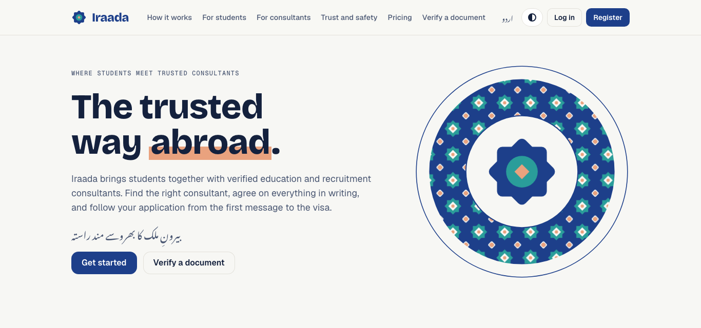
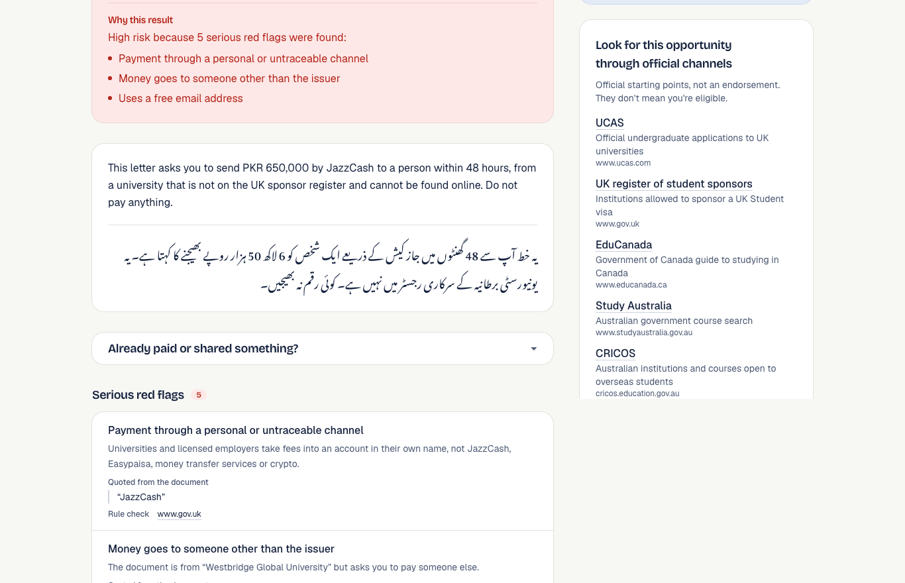
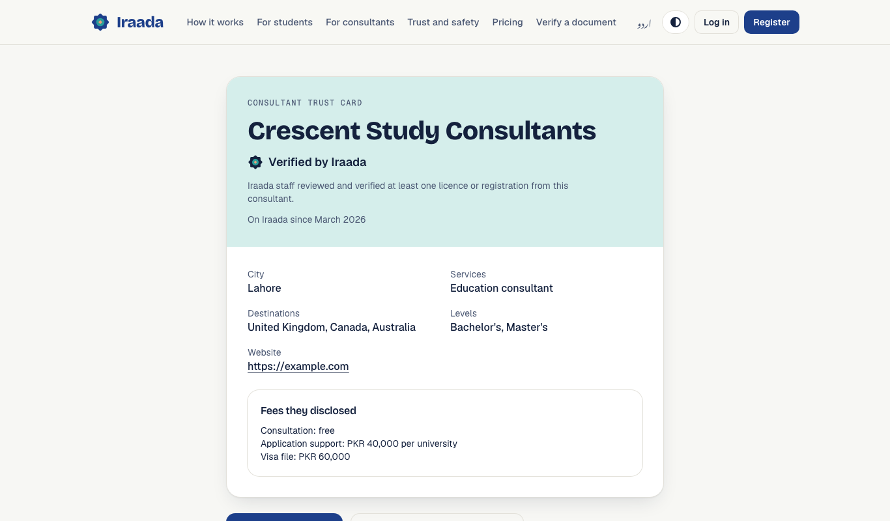
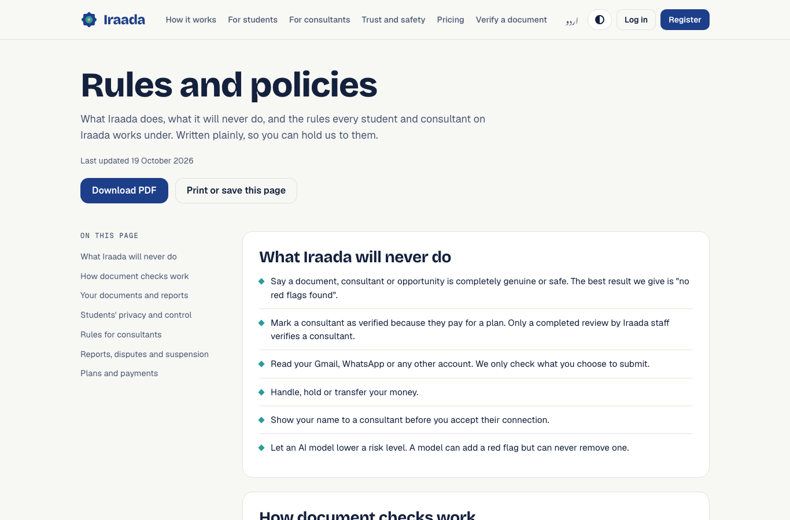
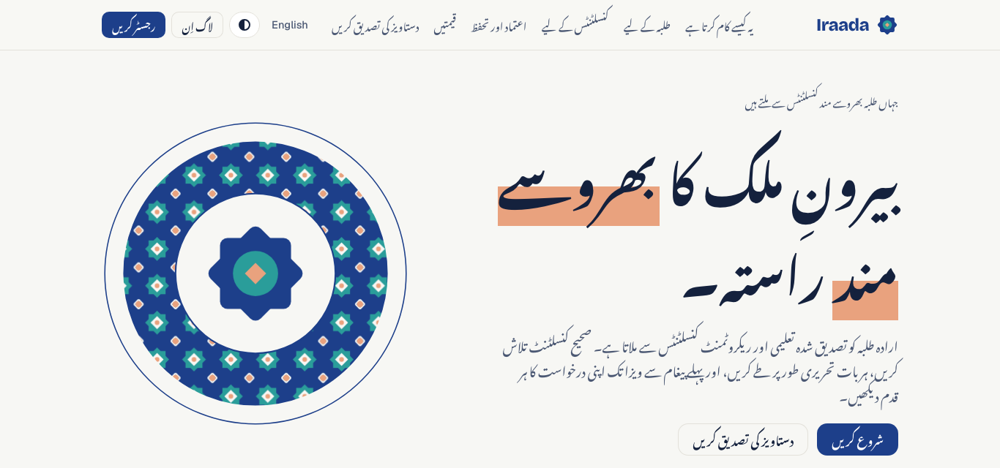
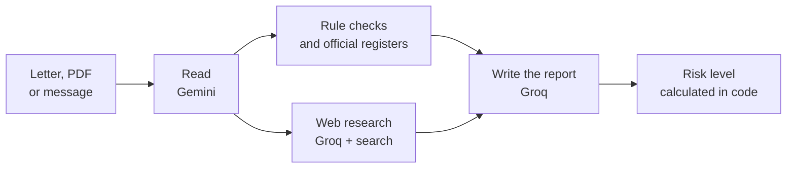

<div align="center">

# Iraada · ارادہ

**The trusted way abroad**

Iraada connects Pakistani students and job seekers with verified education and recruitment consultants, keeps every agreement on record, and lets anyone verify an offer letter or visa document before making a payment.

[Live demo](https://iraada-azure.vercel.app) · Works in English and اردو

</div>



## The problem

Going abroad is one of the biggest financial decisions a Pakistani family makes, and most of it runs on trust nobody can check.

- Students can't tell a licensed consultant from an unlicensed one.
- Fees and promises are agreed over the phone or on WhatsApp, so there's no record when something goes wrong.
- Offer letters, visa letters and job offers are easy to fake, and families usually find out after they've paid.

## How Iraada solves it

| Where trust breaks today | What Iraada does |
| --- | --- |
| No way to tell whether a consultant is licensed | Consultants submit their licence and our team reviews it before the **Verified** badge appears. A paid plan can't buy it. |
| Fees and promises live in WhatsApp chats | Every application has one **shared record** of fees, promises, deadlines and messages that neither side can edit later. |
| Fake letters are discovered too late | Anyone can **verify a document** in minutes, with the evidence for each finding and an Urdu summary for the family. No consultant needed. |
| Students get contacted by anyone with their number | Profiles stay **private** until the student chooses to be visible, and nothing is shared before they accept a connection. |
| Honest consultants look the same as everyone else | Verified consultants get a public **trust card** to share, and **matching** sends them students who fit their expertise. |

The whole site works in English and Urdu, and the rules both sides agree to are on one [policies page](https://iraada-azure.vercel.app/en/policies) that downloads as a PDF.

## Inside Iraada

| Document check report | Consultant trust card |
| :---: | :---: |
|  |  |
| **Rules and policies** | **Fully available in Urdu** |
|  |  |

## 🔍 How a document check works



1. **Read.** Gemini extracts the issuer, payment details, emails, reference numbers and deadlines. It also flags hidden text written to mislead an AI.
2. **Rule checks.** Plain code looks for payments to personal wallets, a payee who isn't the issuer, free email senders, newly registered or look-alike websites and edited PDFs. It also looks the institution up in the UK, Canada and Australia student visa registers.
3. **Web research.** A Groq model searches for the official website, HEC and Bureau of Emigration records, and published scam reports.
4. **Report.** A second Groq model writes the findings with their sources, and a summary in English and Urdu.

**Guardrails**

- The risk level comes from code, not from a model. A model can add a red flag but never remove one, so text hidden in a fake letter can't improve its result.
- Iraada never calls a document genuine. The best result is "no red flags found", along with the official contact to confirm with.
- If a source can't be reached, the report says the check is incomplete. It never treats a failed check as proof of fraud.
- Documents aren't stored. A report is saved only if the user asks, with names, account numbers and phone numbers removed.

### Models and APIs

| Model or source | Role |
| --- | --- |
| Google Gemini `gemini-3.8-flash`, falling back to `gemini-3.5-flash-lite` | Reads the document |
| Groq `openai/gpt-oss-120b` with browser search | Researches the issuer online |
| Groq `openai/gpt-oss-20b` | Writes the findings and the Urdu summary |
| UKVI sponsor register, Canada DLI list, Australia CRICOS | Confirms the institution is registered |
| RDAP | Finds how old a website's domain is |
| PKCERT fake notifications | Matches known scam notices in Pakistan |

Everything runs on free tiers, with per-user and app-wide rate limits so the daily quota isn't used up by one person.

## 🛠️ Tech stack

| Layer | Built with |
| --- | --- |
| App | Next.js 16, React 19, TypeScript |
| Interface | Tailwind CSS 4, next-intl for English and Urdu (right to left) |
| Data and accounts | Supabase: Postgres with Row Level Security, Auth, Storage |
| AI | Google Gemini, Groq |
| Hosting | Vercel, Mumbai region |

## 🚀 Run it locally

You'll need Node.js 20+, pnpm and Docker (for the local Supabase database).

```bash
git clone https://github.com/mh-1005/iraada.git
cd iraada
pnpm install
cp .env.example .env.local     # add free Gemini and Groq keys
supabase start                 # copy the URL and keys it prints into .env.local
pnpm dev                       # http://localhost:3000
```

To try the checker without AI keys, set `MOCK_AI=1` and paste `high`, `medium` or `low` as the message. Unit tests run with `pnpm test`.

---

Database rules, security and known limits are documented in [docs/TECHNICAL.md](docs/TECHNICAL.md).
